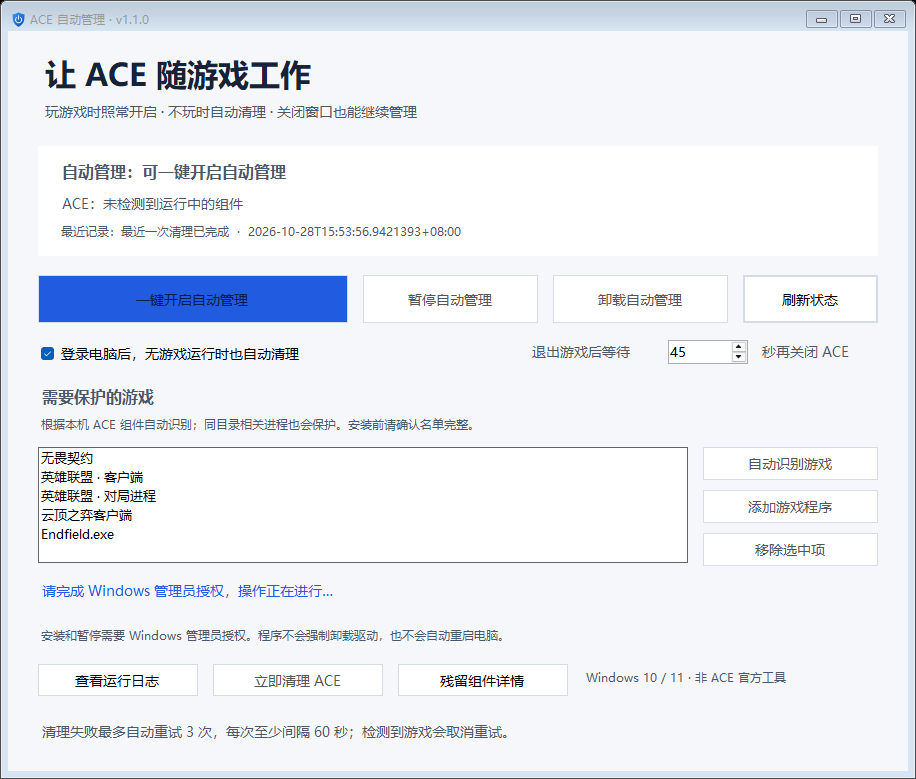

# ACE 自动管理

## 游戏关了，ACE 也该休息了。

退出游戏后，不想让 ACE 反作弊组件继续在后台常驻？

**ACE 自动管理**把手动清理变成一键设置：游戏正常启动 ACE，游戏和相关客户端全部退出后，等待 45 秒，再通过 Windows 的服务控制接口请求关闭 ACE。也可以在登录电脑后，没有游戏运行时自动清理。

**[下载 Windows 单文件 EXE](https://github.com/michael030528/ace-auto-manager/releases/latest/download/ACE-Auto-Manager.exe)** · [所有版本](https://github.com/michael030528/ace-auto-manager/releases)



### 三步上手

1. 下载并双击 `ACE-Auto-Manager.exe`，不需要安装 Python、开发工具或额外的 .NET SDK。
2. 检查窗口中的游戏名单；识别不到时，点“添加游戏程序”。
3. 点击 **一键开启自动管理**，完成 Windows 管理员授权。

之后关闭窗口即可。后台管理独立运行，登录电脑后也会自动启动。

### 能做什么

- **退出后自动清理**：默认连续 45 秒没有游戏或相关客户端，才尝试关闭 ACE。
- **登录后自动清理**：可选开机登录后无游戏时清理；ACE 可能短暂加载，通常约一分钟后退出。
- **游戏优先**：检测到游戏重新启动，会取消本次等待；英雄联盟大厅仍在运行时不会因为一局结束而清理。
- **中文图形窗口**：开启、升级、暂停、卸载自动管理、查看日志。
- **自动发现 ACE 游戏**：读取安装记录及 Steam / WeGame 游戏库，找到真实 ACE 组件文件后再关联相邻游戏程序，不依赖固定游戏名称白名单。
- **目录级保护**：同时留意已识别游戏目录内的其他进程，游戏新增子进程或客户端仍在运行时，保守推迟清理。
- **状态实测**：查询服务、驱动和进程，部分组件未停止时不会当作“全部关闭”。
- **立即清理 ACE**：安装后台后可提交即时清理请求，不等待通常的退出倒计时；后台仍会逐步核对游戏状态，有游戏或客户端时拒绝清理。
- **残留组件详情**：实时列出未停止的驱动、服务及进程 PID，并显示最近清理记录。
- **失败自动重试**：首次清理未完成后最多再尝试 3 次，每次间隔至少 60 秒（设置更长时采用设置值）。游戏或客户端出现会取消重试，退出后重新累计静默期；达到上限后等待新的游戏会话或手动请求。
- **保留启动能力**：不修改 ACE 原始开机项或驱动启动类型；游戏自行启动 ACE，本工具不伪造或绕过反作弊。

### 支持范围

- Windows 10 / 11，64 位，系统具备 .NET Framework 4.5 或更新版本及 Windows PowerShell 5.1（常见 Windows 10/11 安装已具备）。
- 已提供无畏契约、英雄联盟及其云顶客户端的布局适配；其他带有可识别 ACE 组件的游戏会自动加入候选名单，但尚未逐款验证兼容性。
- **请勿在同时运行其他未列入监测的 ACE 游戏时启用本工具。** 不完整的游戏名单可能导致错误判断“游戏已退出”。
- 游戏移动目录后，请重新识别并点击“一键开启自动管理”更新配置。

自动识别会核对 `AntiCheatExpert` 目录中的 `ACE-Setup64.exe`、`ACE-Service64.exe`、`ACE-Helper.exe` 或 SGuard 服务文件，再收集相邻游戏 EXE。单有同名文件夹不会被认作 ACE 游戏。扫描限制在安装记录、游戏平台库和有限目录深度，不做全盘扫描；找到组件却无法关联主程序时会提示手动补充。发现结果是文件结构启发式判断，并非兼容性认证。

本机无畏契约曾实测：退出后 ACE 被关闭，再次打开游戏可重新启动 ACE，无需重启。这不是对所有游戏、版本和电脑的保证。需要预启动模式的游戏可能要求先暂停自动管理，再重启电脑。

### 为什么做这个工具

游戏需要反作弊运行，但不玩游戏时，你也可以选择减少不必要的后台常驻。这个工具主要解决“每次退出都要自己查进程、关托盘”的麻烦。

**不宣称 ACE 一定伤硬盘、窃取隐私或造成卡顿，也不承诺提高帧率、降低温度。** 实际资源占用与机器、游戏版本和运行状态有关。

### 权限、暂停与卸载

查看窗口和读取状态不要求管理员权限。安装、升级、暂停、立即清理和卸载自动任务时，Windows 会请求管理员授权。

- “暂停自动管理”：停用后台任务，ACE 当前状态及其原始启动配置不变。再次点击“一键开启自动管理”恢复。
- “卸载自动管理”：确认后移除自动任务、关闭当前窗口，并删除**当前运行的 EXE**，不删除其他位置的副本，**不卸载 ACE 本体**。后台安装文件、配置和日志保留，便于排查及重新安装。文件仍被占用时最多等待约一分钟；文件内容已改变则取消删除；删除失败会弹窗提示，结果记入日志目录的 `uninstall-result.json`。
- 程序不会自动重启电脑，不会修改 ACE 二进制文件，不会强制卸载拒绝停止的驱动。
- 登录后清理开启时，单纯重启会再次触发清理；若游戏要求预启动，可先暂停本工具。

后台脚本与配置存放在 `%ProgramFiles%\AceGameAutoClose`，只有管理员和 SYSTEM 可写；日志位于 `%ProgramData%\AceGameAutoClose`。程序自身不上传数据，也不访问网络。

本项目是非官方工具，与腾讯、ACE 及游戏发行商无隶属关系。当前 EXE 未进行商业代码签名；下载时请核对本仓库发布页及 `SHA256SUMS.txt`。

### 更新旧版本

下载新版 EXE 并打开，程序读取已有游戏名单、等待时间及登录清理设置。确认名单后点击“一键开启自动管理”，覆盖已安装的后台脚本并更新同一个计划任务。无需先卸载，也不会替换桌面或下载文件夹里的其他 EXE。升级失败时尝试恢复旧脚本、配置及任务。旧后台需要完成这一步升级，才能使用立即清理和自动重试。

### 从源码构建

```powershell
powershell -NoProfile -ExecutionPolicy Bypass -File .\build.ps1
```

构建使用 Windows 自带的 .NET Framework C# 编译器，将后台、监测和发现脚本嵌入 EXE。输出位于 `dist`，不把个人游戏路径、账户 SID、日志或令牌打包进程序。

### 验证

```powershell
powershell -NoProfile -ExecutionPolicy Bypass -File .\tests\Test-State.ps1
powershell -NoProfile -ExecutionPolicy Bypass -File .\tests\Test-Cleanup.ps1
powershell -NoProfile -ExecutionPolicy Bypass -File .\tests\Test-Backend.ps1
powershell -NoProfile -ExecutionPolicy Bypass -File .\tests\Test-Discovery.ps1
powershell -NoProfile -ExecutionPolicy Bypass -File .\tests\Test-DirectoryGuard.ps1
powershell -NoProfile -ExecutionPolicy Bypass -File .\tests\Test-Retry.ps1
powershell -NoProfile -ExecutionPolicy Bypass -File .\tests\Test-Uninstall.ps1
```

覆盖 59 项检查：22 项启动/会话状态、5 种隔离关闭场景、7 项配置校验、4 项自动发现、4 项目录保护、13 项重试及手动清理决策、4 项文件删除检查，另有构建时 EXE 自检。关闭测试使用模拟对象，不操作真实服务或驱动；删除测试仅使用临时测试文件。已检查真实中文窗口、自动发现和只读状态接口；不代表所有机器上的管理员安装、卸载流程及反作弊版本均已验证。

### 许可证

[MIT](LICENSE)
